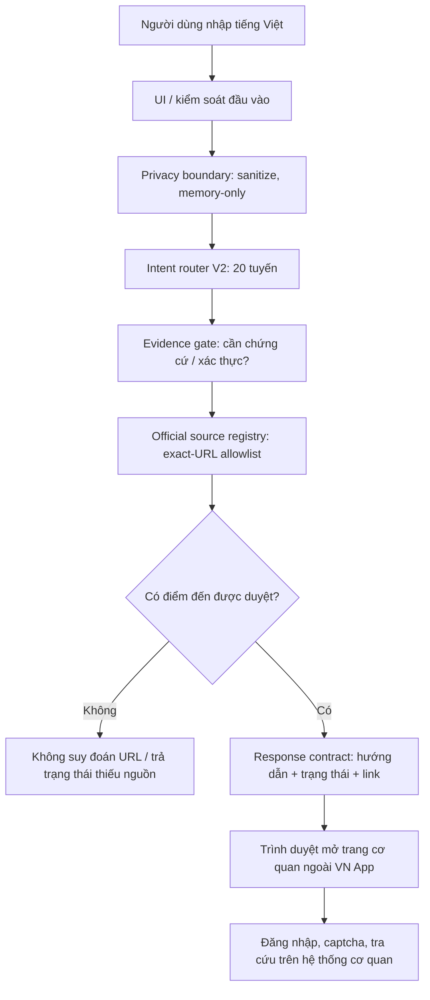
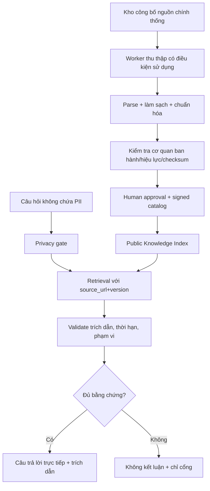

> Tài liệu kiến trúc V3.0 lưu để đối chiếu lịch sử. Trạng thái hiện hành: xem RELEASE_3_13.md. App hiện có IndexedDB cho danh bạ, app tự thêm và mục đã ghim; dùng Capacitor và thư viện quét mã.

# VN App V3.0 — Kiến trúc kỹ thuật và phạm vi thực thi

**Phiên bản:** 3.0.0. **Mốc thiết kế:** 11/10/2026. **Phạm vi thực sự triển khai:** công cụ điều hướng và trả hướng dẫn từ danh mục nguồn tĩnh. Không đồng nghĩa tích hợp dữ liệu công dân hoặc hỏi đáp pháp luật trực tuyến.

## 1. Kiến trúc chạy thật trong V3



**Ranh giới tin cậy:** VN App điều phối bằng danh mục cố định, **không truy cập hồ sơ công dân**. Thông tin cá nhân chỉ nhập trên website/ứng dụng chính thống; VN App không nhúng trang đăng nhập của cơ quan khác.

## 2. Các mô-đun đã có

| Thành phần | Vai trò | Trạng thái |
|---|---|---|
| `data.js` | 8 ứng dụng, 13 website, 13 nhóm tác vụ | Kế thừa V2 |
| `engine.js` | Chuẩn hóa tiếng Việt, nhận ý định, chặn mẫu PII | Kế thừa V2, 20 intent |
| `core/trust-registry.js` | Danh mục URL chính xác, gói ứng dụng được pin theo URL, hạ cấp link cũ, từ chối URL ngoài sổ | Đã chạy |
| `core/evidence.js` | Nhận biết truy vấn liên quan dữ liệu riêng và câu hỏi pháp luật/cước phí cần chứng cứ mới | Đã chạy ở mức quy tắc, không phải máy thẩm định luật |
| `core/orchestrator.js` | Điều phối luồng, gắn trạng thái, thực thi chính sách nguồn, chuẩn hóa đầu ra | Đã chạy |
| `script.js` | UI giao nhận tác vụ, hiển thị mức độ hoàn thành và chuyển ra trang chính thức | Đã tích hợp |
| `tests/` | Test bộ định tuyến cũ, trust boundary mới và UI DOM giả | Đã chạy |

Không dùng thư viện bên thứ ba, tài khoản VN App, bộ nhớ trình duyệt cho dữ liệu người dùng, CSDL máy chủ, gọi HTTP trong bộ xử lý hiện tại. Danh mục nguồn là dữ liệu mã nguồn, không phải kết quả kiểm tra kết nối live.

## 3. Hợp đồng trả kết quả V3

```json
{
  "version": "3.0.0",
  "status": "MATCHED | MULTIPLE_MATCHES | EMPTY | PRIVATE_INPUT | NO_VERIFIED_ROUTE",
  "sensitive": false,
  "message": "Mô tả có giới hạn",
  "results": [
    {
      "id": "bhytvalid",
      "task": "bhyt",
      "category": "AUTH_OR_CAPTCHA",
      "title": "Kiểm tra giá trị sử dụng thẻ BHYT",
      "answer": "Hướng dẫn cố định đã biên tập",
      "steps": ["..."],
      "actions": [{"label":"...", "url":"https://...", "level":"direct | portal", "agency":"...", "sourceState":"catalogued", "reviewNeeded":false}],
      "sourceState": "CATALOGUED_NOT_LIVE_CHECKED",
      "decision": {
        "outcome":"EXTERNAL_AUTH_REQUIRED",
        "disclaimer":"...",
        "requiresEvidence":false,
        "requiresSystem":true
      }
    }
  ],
  "diagnostics": {"sourceMode":"STATIC_CATALOG", "remoteApi":false, "personalDataAccess":false}
}
```

Không có `query`, họ tên, biển kiểm soát, định danh hay OTP trong hợp đồng đầu ra. `status=MATCHED` chỉ nghĩa là khớp **ý định**, không khẳng định hoàn thành nghiệp vụ.

## 4. Chính sách nguồn

1. URL phải là HTTPS chuẩn, không credentials, fragment, port lạ, ký tự điều khiển hoặc dạng dễ giả mạo.
2. Website/đường dẫn chỉ được phép khi khớp hoàn toàn một địa chỉ đã đăng ký. Các `store id` phải nằm trong danh mục gói cố định.
3. Phân biệt `direct` là trang biểu mẫu cụ thể với `portal` là cổng chính phải chọn chức năng tiếp.
4. Đường dẫn cũ của thủ tục đổi GPLX và thông báo lưu trú ở V2 bị chuyển về cổng DVC, kèm dấu `reviewNeeded` cho tới khi trang chi tiết ở hệ thống mới được xác minh.
5. `catalogued` = tồn tại trong sổ nguồn; không khẳng định dịch vụ hoạt động hiện tại, thẩm quyền xử lý hay hiệu lực văn bản.
6. Trình duyệt và trang đích có thể điều hướng tiếp; cho nên cần một hệ thống **kiểm tra redirect từ máy chủ trong quá trình phát hành** để đảm bảo đích cuối vẫn chính thống. V3 chưa triển khai giám sát này.

**Bằng chứng công khai về chuyển đổi DVC:** [Thông báo 21/04/2026](https://vpcp.dichvucong.gov.vn/p/home/dvc-chi-tiet-tin-tuc.html?new_id=982), [thông báo vận hành 29/05/2026](https://thutuc.dichvucong.gov.vn/p/home/dvc-chi-tiet-tin-tuc.html?new_id=1002).

**Nguồn chứng thực tuyến BHYT:** [hướng dẫn của BHXH Việt Nam](https://baohiemxahoi.gov.vn/tintuc/Pages/hoat-dong-he-thong-bao-hiem-xa-hoi.aspx?CateID=0&ItemID=23797).

## 5. Kết quả có ý nghĩa gì?

- `GUIDANCE_READY`: trả hướng dẫn từ danh mục, chưa xác minh live.
- `PROCEDURE_LINK_READY`: có URL đến trang thủ tục; chưa chắc trang còn phục vụ.
- `SOURCE_CHECK_REQUIRED`: câu hỏi về lệ phí, thời hạn, điều kiện, mức phạt chưa có chứng cứ văn bản hiện hành đủ để trả lời trực tiếp.
- `EXTERNAL_AUTH_REQUIRED`: chỉ trang chính thức có thể cung cấp kết quả của một cá nhân.
- `EMERGENCY_HANDOFF`: nhấn mạnh gọi trực tiếp số 113/114/115. VN App không phải tổng đài.
- `NO_VERIFIED_ROUTE`: không có URL được phép; không trả bịa.

## 6. Kiến trúc mục tiêu V4 (CHƯA triển khai)



### Metadata bắt buộc của mỗi mục nguồn V4

`source_id`, `issuing_agency`, `source_url`, `publication_date`, `effective_from`, `effective_to`, `retrieved_at`, `last_verified_at`, `content_checksum`, `evidence_type`, `jurisdiction`, `status`, `reviewer`, `superseded_by`.

Phải có kiểm tra văn bản hết hiệu lực/sửa đổi, nguồn có thẩm quyền, các điểm mâu thuẫn, thay đổi địa giới hoặc thẩm quyền giải quyết. Hệ thống không có khả năng tự xác nhận hiệu lực từ tên miền.

### API cá nhân V4

Chỉ thiết kế adapter nếu cơ quan cung cấp API chính thức, phạm vi truy cập và điều kiện bảo mật hợp lệ. Khi chưa được cấp quyền, adapter trả `NOT_AVAILABLE` và dẫn sang hệ thống cơ quan. Không cho nhập CCCD, mã số BHXH, OTP hoặc mật khẩu trong VN App.

## 7. Hiệu năng / khả năng hoạt động / bảo vệ dữ liệu

- Kiến trúc `static-first`, không yêu cầu server để nhận diện tác vụ: có thể hiển thị và phân loại khi mất mạng nếu gói HTML/CSS/JS đã có sẵn; mở liên kết đích vẫn cần kết nối.
- Không khai báo service worker cache tài liệu công dân hoặc trang login; bản V3 chưa phát hành PWA offline cài đặt.
- Không lưu lịch sử yêu cầu, không analytics, không cookie định danh, không localStorage/IndexedDB.
- Sanitizer quy tắc chỉ giảm thiểu rò lọt PII phổ biến; không thể đảm bảo chặn mọi tên người và dữ liệu riêng. Có cảnh báo UI để người dùng không nhập thông tin cá nhân.
- CSP hiện tại là meta CSP cho giao diện tĩnh. Khi đưa lên HTTPS cần cấu hình HSTS, CSP header có `frame-ancestors`, `X-Content-Type-Options`, `Referrer-Policy: no-referrer`, và `Permissions-Policy` tại reverse proxy.

## 8. Nghiệm thu

Lệnh `npm run check`. V3 đã chạy 56 assertion của V2, 74 assertion logic nguồn/điều phối, 8 kiểm thử UI giả lập. Test Chromium trong môi trường phát triển bị timeout; chưa nghiệm thu UI trên Chrome Android, Safari iOS, liên kết thực, hay dữ liệu trực tuyến.
